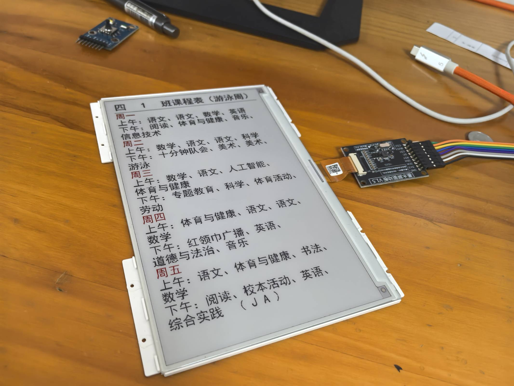
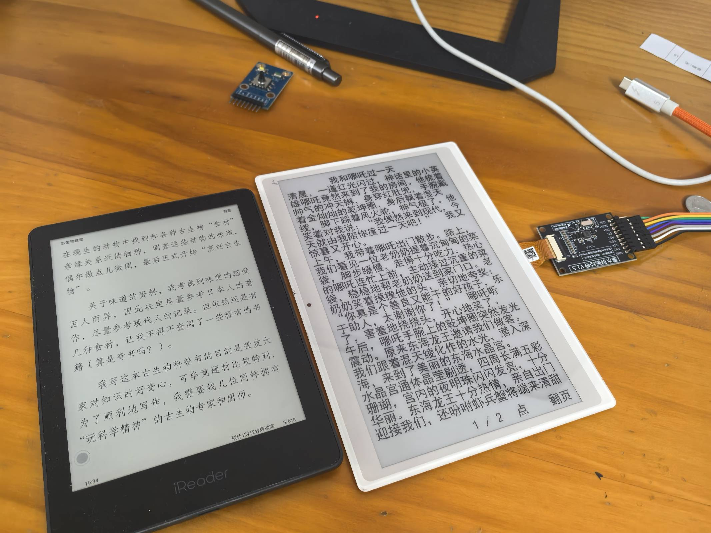
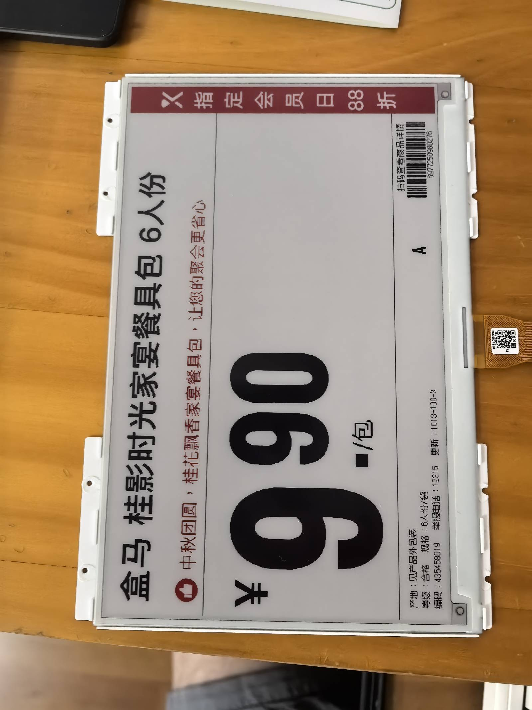
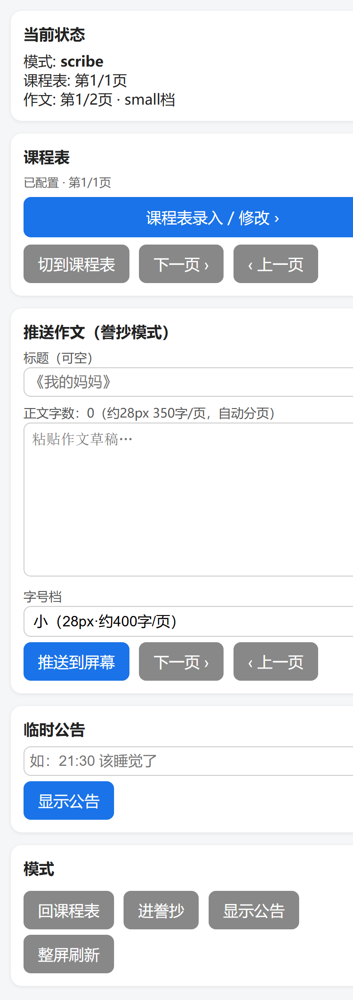
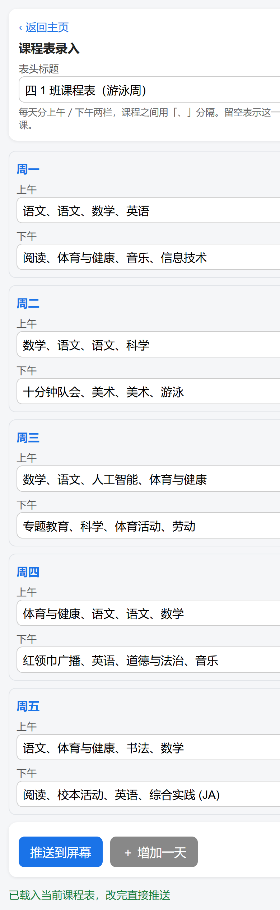
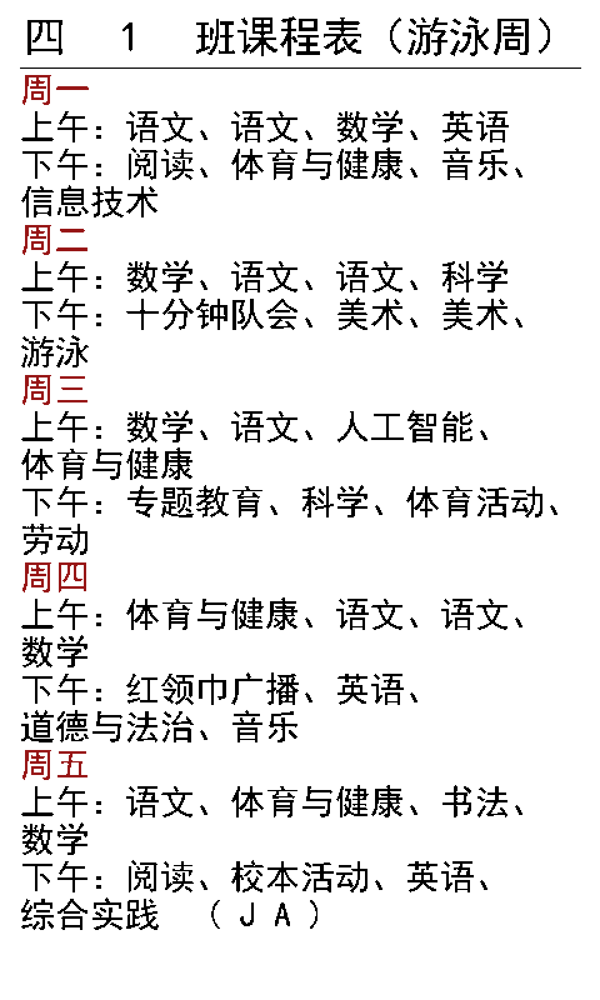
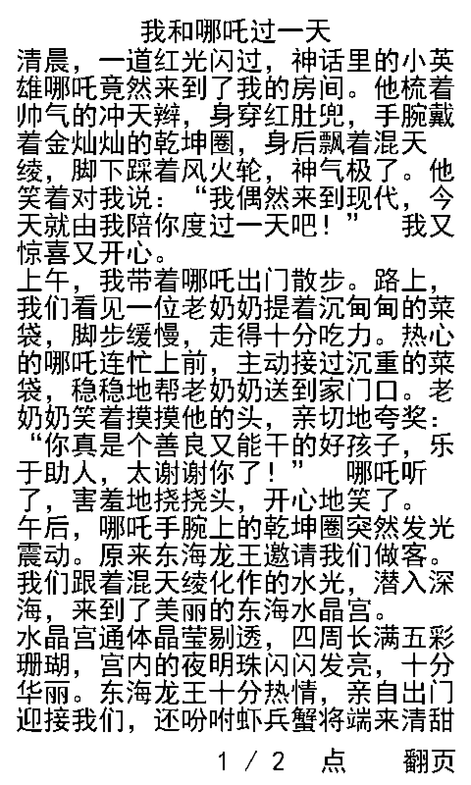

# epaper-panel · 书桌边的墨水屏投喂面板

ESP32-S3 + 7.5 寸黑白红墨水屏（GxEPD2_750c_GDEW075Z08，800×480 物理分辨率，**竖屏**显示）
组成的家庭内网投屏面板。手机连同一个 WiFi，浏览器打开面板的 IP 就能把内容投到墨水屏上。

- **课程表**：分天录入，每天上午/下午两栏，常驻显示
- **作文誊抄**：粘贴草稿 → 稿纸样式逐行排版，自动分页，三档字号
- **临时公告**：一行大字，随时覆盖显示

| 课程表实机照片 | 誊抄模式（左:iReader 右:本项目） |
|---|---|
|  |  |

## 为什么要做这个

**起因是这两件小事。** 孩子抄好课程表贴在文具盒或书桌上，没几天就掉了、皱了；而且现在小学一周的课排得挺满，光科目就十几门，孩子一次次手抄既慢又容易抄错。打印出来当然清楚，但那张纸在家里同样会失踪——压在书堆下、夹在别的本子里，要找的时候永远找不到。

至于为什么不干脆买台打印机：家里打印场景其实不多，主要就是给孩子打打要誊抄的作文、打几页练习题。为这个买喷墨机，最怕的就是放久了堵喷头——一星期不打，用的时候准出问题；买激光机又犹豫，密闭房间里打印时那股味道实在算不上好，不想为了一个月一次的需求在家里添这么个东西。

后来在网上看到别人用墨水屏做的类似项目（这块屏最早就是拿来玩超市电子价签的），才反应过来：一块 7.5 寸墨水屏本来就够放一屏课程表，也够放一篇作文的誊抄稿——墨水屏常亮不耗电、不发光、不伤眼，正好像一块贴在书桌边的"纸"，而且内容随时能换，永远不会丢。于是借鉴了几个开源项目的经验，花了大半天时间，用 AI 把固件写了出来。

| 这块屏的"前世"：超市电子价签 |
|---|
|  |

跑了一段时间，感觉还不错。唯一的小遗憾是买屏的时候没买好，选的是黑白红**三色**屏，刷新时间比预期长一些；但日常切页、推送内容的等待都在可接受范围内，基本达到了自己用的预期。

**接下来想做的**：3D 打印一个外壳，把主控和屏几块板子整合进一个像样的盒子里，再配一块小锂电池供电——不用拖着 Type-C 线，往书桌一角一放就能用，可用性会好很多。

## 界面

### 投喂主页 `GET /`



### 课程表录入 `GET /tt`（主页二级页）



### 墨水屏实际显示效果

| 课程表 | 作文誊抄 |
|---|---|
|  |  |

## 硬件

| 项目 | 规格 |
|---|---|
| 主控 | ESP32-S3（带 PSRAM，WiFi 2.4G），装在**分立墨水屏转接板**上 |
| 屏幕 | MMK-E075A41 / GDEY075Z08，7.5 寸，800×480，黑/白/红三色（三色屏整屏刷新偏慢，见"已知限制"） |
| 驱动 | `GxEPD2_750c_GDEY075Z08`（UC8179），`setRotation(1)` → 逻辑 480×800 竖屏 |
| 接线 | 转接板自带升压电路与 24pin FPC 座，裸屏直插转接板；S3 主板只出 6 根信号线：`SCK=11 MOSI=10 CS=9 DC=8 RST=7 BUSY=6`（3V3/GND 由转接板供给） |
| 存储 | LittleFS（分区 app 12.5MB，见 `partitions.csv`） |
| 供电 | Type-C，**墨水屏刷新峰值电流较大，建议独立 2A 供电** |

## 固件编译与烧录

Arduino IDE / arduino-cli 打开 `firmware/epd_panel/epd_panel.ino`（**sketch 目录名必须保持 `epd_panel`**，Arduino 要求目录名与 ino 同名）。
库依赖：**GxEPD2**、**U8g2_for_Adafruit_GFX**、**ArduinoJson**、**ESPAsyncWebServer + ESPAsyncTCP-esynchronization**（Library Manager 安装即可）。

```bash
# 编译（自定义分区，app 12.5MB）
arduino-cli compile --fqbn esp32:esp32:esp32s3:FlashSize=16M,FlashMode=qio,PSRAM=opi,PartitionScheme=custom \
  firmware/epd_panel

# 编译 + 烧录一条龙（默认 COM6，可用 PORT=COM8 覆盖）
./tools/build_panel.sh          # 仅编译
./tools/build_panel.sh upload   # 编译并烧录
```

## 目录结构

```
firmware/epd_panel/        # Arduino sketch（目录名须与 ino 同名）
├── epd_panel.ino        # 主循环：WiFi 配网、HTTP 服务、渲染调度
├── api_panel.cpp/.h     # 投喂页 HTML 与 REST 接口
├── content_store.cpp/.h # LittleFS 存取 + JSON 兼容解析
├── render_panel.cpp/.h  # 排版与绘制（课程表 / 誊抄 / 公告）
├── panel_types.h        # 内部数据结构
├── fonts_ink.cpp/.h     # 中文字库（三档，u8g2 v1 格式，2.35MB）
└── partitions.csv       # 自定义分区（app 12.5MB）

docs/
├── photos/              # 实机照片（课程表 / 誊抄对比 / 电子价签前世）
└── screenshots/         # 投喂页截图与墨水屏渲染效果图

tools/
├── host_render.py       # 主机端像素级预览（烧录前先看效果）
├── v1_verify.py         # u8g2 v1 字库解码器（预览与校验共用）
├── parse_cfont.py       # C 字库数组解析
├── gen_fonts_v1.py      # TTF → BDF → u8g2 v1 字库流水线
├── make_bdf.py          # Pillow 渲染位图 → BDF
├── build_panel.sh       # 编译 + 烧录脚本
└── shoot_web.sh         # 抓取投喂页截图
```

> 字库流水线还需要 u8g2 官方 `bdfconv.exe`（`gen_fonts_v1.py` 里 `U8G2` 常量指向其目录），
> 未随仓库分发；日常构建**不需要**重跑字库，`fonts_ink.cpp` 已预生成入库。

## 中文字库

`simhei.ttf` → PIL 渲染位图 → BDF → `bdfconv -f 1` → `fonts_ink.cpp`。

三档字号 **28 / 34 / 44 px**，本字库 advance 恒等于字号。

| 档位 | 压缩后大小 | 字数 |
|---|---|---|
| small (28px) | 617,783 B | 6881 |
| mid (34px) | 802,107 B | 6881 |
| big (44px) | 1,026,813 B | 6881 |

**u8g2 v1 格式硬限制**：单个字形压缩后必须 ≤255 字节，44px 档用阈值 180 规避。

## 接口

| 方法 | 路径 | 说明 |
|---|---|---|
| GET | `/` | 投喂主页 |
| GET | `/tt` | 课程表录入页（二级页，自动回填） |
| POST | `/api/timetable` | 提交课程表 JSON |
| GET | `/api/timetable` | 读回当前课程表 JSON |
| POST | `/api/scribe` | 提交作文 `{title, text, font}` |
| GET | `/api/scribe` | 读回作文原文（调试用） |
| POST | `/api/display` | 显示临时公告 |
| POST | `/api/mode` | 切换模式：`timetable` / `scribe` / `notice` / `next` / `prev` / `refresh` |
| GET | `/api/status` | 当前状态（模式、页码、字号档、剩余堆） |

### 课程表 JSON

```json
{
  "title": "四 1 班课程表（游泳周）",
  "days": [
    { "name": "周一", "am": "语文、语文、数学、英语", "pm": "阅读、体育与健康、音乐、信息技术" }
  ]
}
```

同时兼容 `am`/`pm` 字段、数组式 `courses`、字符串式 `days` 等多种历史格式。

## 已知限制

- 黑白红**三色屏**整屏刷新比双色屏慢（约数秒），切页有明显等待；这是选屏时的遗憾，介意刷新速度可换 GDEW075T7 一类双色屏
- 墨水屏刷新有残影，频繁切换内容建议间隔数秒，或用 `refresh` 模式做整屏刷新
- 单页课程表容量 24 行（16 字/行），超出会自动分页
- 誊抄页固定 26 行/页，按**行数**而非字数分页
- 行首禁则已实现：标点不会落在行首，会把上一字挤到下一行
